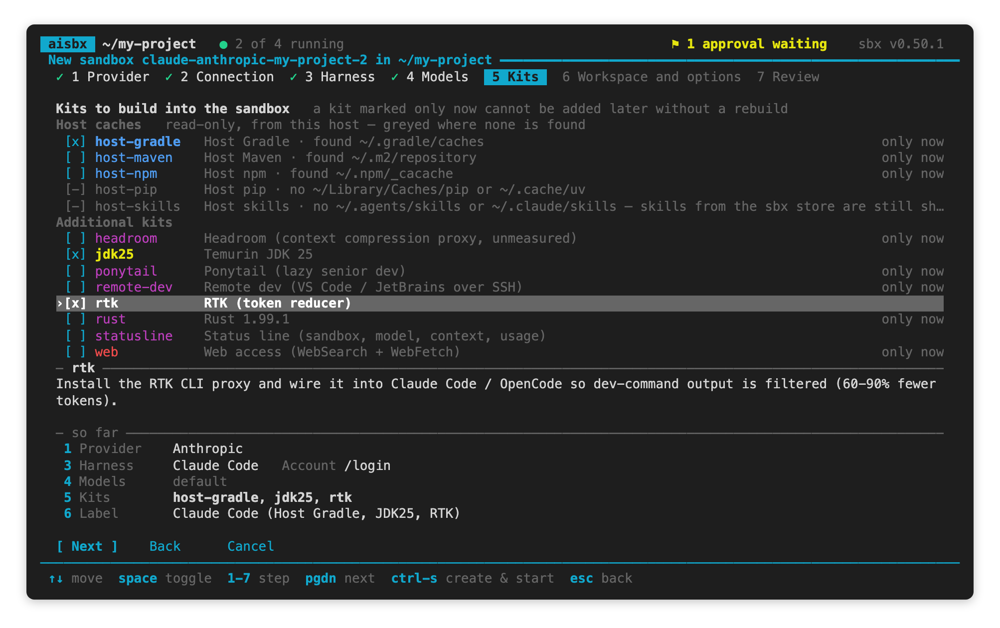
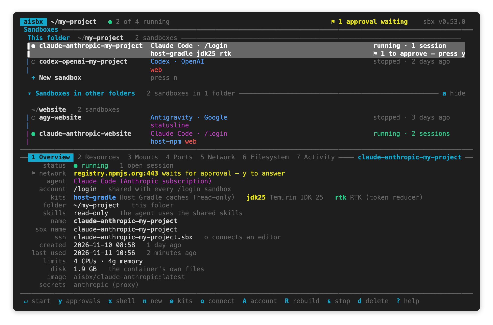
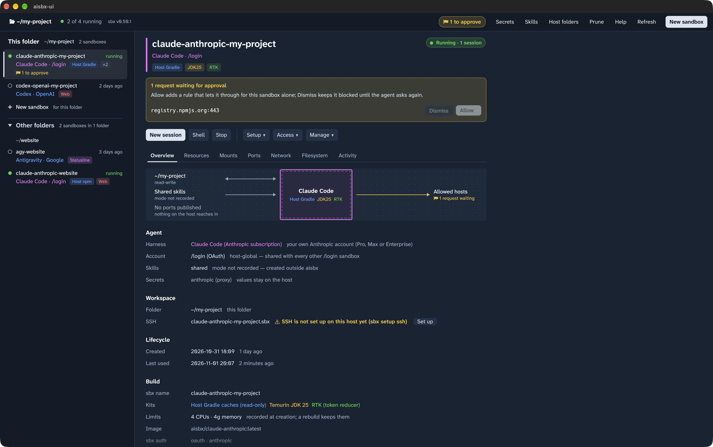

# aisbx

[](https://github.com/ilja82/aisbx/actions/workflows/ci.yml)
[](LICENSE)
[](https://docs.docker.com/ai/sandboxes/)


aisbx is a wrapper around [Docker Sandboxes](https://docs.docker.com/ai/sandboxes/) (`sbx`). sbx runs AI
coding agents in isolated sandboxes. aisbx adds ready kits for agents on your own accounts and gateways, and
manages every sandbox from one dashboard. Each action in aisbx runs plain `sbx` commands, so you need sbx first.

The agents are Claude Code, OpenCode, Codex, [Pi](https://pi.dev) and the Antigravity CLI. Each runs in its own
sandbox with your project folder in it.

**Contents:** [What sbx provides](#what-sbx-provides) · [What aisbx adds](#what-aisbx-adds) ·
[How it fits together](#how-it-fits-together) · [Requirements](#requirements) · [Install](#install) ·
[Your first sandbox](#your-first-sandbox) · [Everyday use](#everyday-use) ·
[Headless](#headless-aisbx-from-scripts) · [Backends](#backends) · [Addons](#addons) ·
[Without aisbx](#without-aisbx) · [Documentation](#documentation) · [Help and contributing](#help-and-contributing) ·
[License](#license)

## What sbx provides

aisbx builds on these sbx features. It does not replace them.

- **Isolation:** each sandbox is a small VM with your project folder mounted. The agent cannot reach the rest of
  the host.
- **Agents in the sandbox:** sbx runs the agent harness inside the VM and builds its image from **kits**.
- **Keys stay on the host:** `sbx secret` stores keys and tokens in the host keychain. The sbx proxy on the host puts
  them into the agent's requests, so the agent never sees them ([Credentials](docs/accounts.md#credentials)).
- **Egress control:** the network policy blocks every host that no rule allows, and holds a blocked request for
  your approval ([Network policy](docs/network.md#network-policy)).
- **A skills store:** one store of agent skills on the host, shared by the sandboxes
  ([The sbx skills store](docs/skills.md#the-sbx-skills-store)).
- **An MCP gateway:** MCP servers registered on the host, with their OAuth tokens kept there
  ([MCP servers](docs/sandboxes.md#mcp-servers)).
- **Sandbox tools:** ports, SSH for editors, CPU and memory limits ([Working with sandboxes](docs/sandboxes.md)).

## What aisbx adds

- **Backend kits for five agents on your own accounts:** a LiteLLM gateway, a model on this computer, your
  Anthropic, OpenAI or Google account, or a setup token ([Backends](#backends)).
- **LiteLLM connections:** add a gateway once, read its model list, and pin models per sandbox
  ([LiteLLM connections](docs/litellm.md)).
- **Local inference engines:** run Pi, Claude Code and OpenCode on a model served by llama.cpp, Ollama, LM Studio,
  MLX or vLLM on this computer. aisbx finds the engines and says which agent fits a small context
  ([Local inference engines](docs/local.md)).
- **Two Anthropic accounts at once**, through named setup tokens
  ([Two Anthropic accounts](docs/accounts.md#two-anthropic-accounts-at-once)).
- **Addons** that stack onto every backend: JDK, Rust, read-only host caches, host skills, RTK and more
  ([Addons](#addons)).
- **Tight allow-lists:** each kit opens only the hosts its agent needs, and turns the agents' telemetry off
  ([Telemetry](docs/network.md#telemetry-and-non-essential-traffic)).
- **Credential bindings set for you:** without a binding, sbx silently withholds a credential. aisbx adds it before
  each create, rebuild or start ([Credentials](docs/accounts.md#credentials)).
- **Skill repositories:** Git repositories of skills that aisbx mirrors, with skills picked per sandbox
  ([Skill repositories](docs/skills.md#skill-repositories-aisbx-skill-repo)).
- **A dashboard** in the terminal (`aisbx`) and as a desktop window (`aisbx-ui`): many sandboxes per project, a
  create wizard, approvals, rebuilds that keep your settings, and update detection ([The aisbx dashboard](docs/dashboard.md)).
- **Headless commands** for scripts and CI ([Headless use](docs/headless.md)).
- **No telemetry** from the agents, and sbx's own telemetry off unless you turned it on
  ([sbx's own telemetry](docs/network.md#sbxs-own-telemetry-t)). Keys stay in the host keychain
  ([one exception](docs/agents.md#antigravity-agy)).

## How it fits together


- **sbx** runs each sandbox as a small VM with your project folder in it. Its host proxy adds your keys to the
  agent's requests and blocks every host the policy does not allow.
- **Kits** set up the agent: one **backend** (the agent and its account) and any number of **addons** (tools).
- **aisbx** stores your connections and tokens and runs the `sbx` commands, from a terminal dashboard, a desktop
  window or scripts. All three show the same sandboxes, on macOS, Linux and Windows.

## Requirements

- [sbx](https://docs.docker.com/ai/sandboxes/) **0.51.0** or later, signed in to Docker
  ([Install](#1-install-sbx)). The dashboard refuses an older version ([why](docs/development.md#sbx-version)).
- Docker with Buildx on the host. sbx uses it to build the image of each kit.
- To build from source only: a Rust toolchain. The launcher builds aisbx with it. `aisbx-ui` needs Rust 1.95 or
  later ([Requirements](docs/gui.md#requirements)).

## Install

Install sbx, sign in to Docker, set the network policy, then install aisbx.

### 1. Install sbx

Install the `sbx` CLI from Docker. Check it with `sbx version`: aisbx needs 0.51.0 or later.

| Platform      | Command                                                         |
|---------------|-----------------------------------------------------------------|
| macOS         | `brew trust docker/tap && brew install docker/tap/sbx`          |
| Windows       | `winget install -h Docker.sbx`                                  |
| Ubuntu        | `curl -fsSL https://get.docker.com \| sudo SBX=1 sh` (with Docker Engine) |

sbx has its own platform requirements: Apple silicon on macOS, Windows Hypervisor Platform on Windows, and KVM on
Linux. [Install Docker Sandboxes](https://docs.docker.com/ai/sandboxes/install/) lists them and the other ways to
install.

### 2. Sign in to Docker

sbx needs a Docker sign-in. Run this once; it opens a browser:

```console
$ sbx login
```

### 3. Set the network policy

Turn off every online connection by default, once:

```console
$ sbx policy init deny-all
```

aisbx manages the connections itself: each kit opens only the hosts its agent and tools need. Any other request
waits for your approval. If sbx already has a policy, run `sbx policy reset --force && sbx policy init deny-all`
instead. **This command stops every sandbox.** Do not choose the `balanced` preset: it opens GitHub, npm and more to
every sandbox, whatever the kits say ([Network policy](docs/network.md#network-policy)).

### 4. Install aisbx

Install with Homebrew, install a release, or build from source.

#### With Homebrew

On macOS and Linux, install both binaries from the tap:

```console
$ brew install ilja82/tap/aisbx
```

To update, run `brew upgrade aisbx`. Homebrew does not quarantine the binaries.

#### From a release

1. Download the archive for your platform from the
   [latest release](https://github.com/ilja82/aisbx/releases/latest):

   | Platform             | Archive                                            |
   |----------------------|----------------------------------------------------|
   | macOS, Apple silicon | `aisbx-<version>-aarch64-apple-darwin.tar.gz`      |
   | macOS, Intel         | `aisbx-<version>-x86_64-apple-darwin.tar.gz`       |
   | Linux, x86-64        | `aisbx-<version>-x86_64-unknown-linux-gnu.tar.gz`  |
   | Linux, ARM64         | `aisbx-<version>-aarch64-unknown-linux-gnu.tar.gz` |
   | Windows, x86-64      | `aisbx-<version>-x86_64-pc-windows-msvc.zip`       |

   Each archive has a `.sha256` file. On macOS or Linux, check it with `shasum -a 256 -c <archive>.sha256`.

2. Unpack the archive to a folder of your choice. Keep `bin/` and `kits/` together: aisbx reads its kits from
   the folder above `bin/`.

3. Put the `bin/` folder of the unpacked archive on your `PATH`. Use the commands of step 2 in
   [From source](#from-source), with that folder.

4. On macOS, remove the download quarantine once. The binaries are not signed by Apple:

   ```console
   $ xattr -dr com.apple.quarantine /path/to/aisbx-<version>-aarch64-apple-darwin
   ```

The Linux binaries need the glibc of Ubuntu 24.04 or newer. `aisbx-ui` on Linux also needs X11 or Wayland.
To update, unpack the new release and change the `PATH` entry.

#### From source

1. Clone the repository:

   ```console
   $ git clone https://github.com/ilja82/aisbx.git
   ```

2. Put the launcher folder of your platform on your `PATH`:

   | Platform     | Folder          | Launcher                                             |
   |--------------|-----------------|------------------------------------------------------|
   | macOS, Linux | `bin/unix/`     | `aisbx` and `aisbx-ui`                               |
   | Windows      | `bin\windows\`  | `aisbx.cmd` and `aisbx-ui.cmd` (PowerShell 5.1 or 7) |

   On macOS and Linux, add this line to your shell profile:

   ```sh
   export PATH="/path/to/aisbx/bin/unix:$PATH"
   ```

   On Windows, run this once in PowerShell, then open a new terminal:

   ```powershell
   $p = [Environment]::GetEnvironmentVariable("Path", "User")
   [Environment]::SetEnvironmentVariable("Path", "$p;C:\path\to\aisbx\bin\windows", "User")
   ```

The launcher builds aisbx on the first run and after each `git pull`
([The `aisbx` launcher](docs/dashboard.md#the-aisbx-launcher)).

## Your first sandbox

1. Open the dashboard in your project folder:

   ```console
   $ cd ~/my-project
   $ aisbx          # in the terminal
   $ aisbx-ui       # or: as a desktop window
   ```

   Start `aisbx-ui` from a shell, not from Finder or the Dock.

2. Press `n` in `aisbx`, or click **New sandbox** in `aisbx-ui`. Pick the AI provider, the agent, its account and
   the addons, then select **Create & start**.

   

   You set up every account in the UI. Only Codex needs one command on the host first:
   `sbx secret set openai --oauth` ([Codex](docs/agents.md#codex)).

To start it again later, select it and press `↵`, or click **Start**.

## Everyday use

### In the terminal: `aisbx`



The keys you use most: `n` new, `↵` start, `x` shell, `e` kits, `y` approvals, `s` stop, `d` delete, `?` every key.
[Common tasks](docs/dashboard.md#common-tasks) lists more.

### In the window: `aisbx-ui`

The window has the same actions as buttons and menus, and every key works in it too
([The aisbx-ui GUI](docs/gui.md)).



## Headless: aisbx from scripts

For CI, nightly jobs and other scripts. The commands use the same kits, connections and tokens as the dashboard.

```console
$ aisbx up --backend claude-anthropic --clone --skills off --name nightly ~/my-project
nightly
$ aisbx run nightly --prompt-file task.md --timeout 2h --report run.json > result.json
$ aisbx status nightly --json
$ aisbx rm nightly
```

`up` creates the sandbox and prints its name, and `run` runs the agent once on a prompt.
[Headless use](docs/headless.md) describes every command.

## Backends

A backend is the kit that runs the agent. Each sandbox has one backend.

| Backend            | Agent       | Account                                                         |
|--------------------|-------------|-----------------------------------------------------------------|
| `claude-litellm`   | Claude Code | a [LiteLLM connection](docs/litellm.md)                         |
| `claude-anthropic` | Claude Code | your Anthropic subscription, through [`/login`](docs/accounts.md#login-one-account-per-machine) |
| `claude-token`     | Claude Code | an Anthropic subscription, through a [named setup token](docs/accounts.md#setup-tokens-a-second-account) |
| `opencode-litellm` | OpenCode 2.x | a [LiteLLM connection](docs/litellm.md) ([OpenCode](docs/agents.md#opencode)) |
| `pi-litellm`       | [Pi](https://pi.dev) | a [LiteLLM connection](docs/litellm.md) ([Pi](docs/agents.md#pi)) |
| `pi-local`         | [Pi](https://pi.dev) | a [local inference engine](docs/local.md) (recommended for a local model) |
| `claude-bare-local` | Claude Code bare (`claude --bare`) | a [local inference engine](docs/local.md#claude-code-bare) |
| `opencode-local`   | OpenCode 2.x | a [local inference engine](docs/local.md) |
| `claude-local`     | Claude Code | a [local inference engine](docs/local.md) (best with 32k context or more) |
| `codex-openai`     | Codex       | your OpenAI account: the ChatGPT sign-in or an API key ([Codex](docs/agents.md#codex)) |
| `agy`              | Antigravity CLI | your Google account, or a Gemini API key ([Antigravity](docs/agents.md#antigravity-agy)) |

## Addons

Pick addons in the create wizard or with `e`. [Stackable kits](docs/addons.md) describes each one.

| Addon                        | Gives the sandbox                                                          |
|------------------------------|----------------------------------------------------------------------------|
| `jdk25`                      | [Temurin JDK 25](docs/addons.md#jdk--java-projects)                        |
| `rust`                       | [Rust](docs/addons.md#rust-projects): rustc, cargo, clippy, rustfmt        |
| `host-gradle`, `host-maven`  | [the host's Gradle and Maven caches](docs/addons.md#host-mavengradle-caches-read-only), read-only |
| `host-npm`, `host-pip`       | [the host's npm, pip and uv caches](docs/addons.md#host-npmpipuv-caches-read-only), read-only |
| `host-skills`                | [the host's own skills](docs/addons.md#host-skills-read-only), read-only and live |
| `web`                        | [access to every host](docs/addons.md#web-access-websearch--webfetch), for WebFetch and web search |
| `remote-dev`                 | the hosts that [VS Code, Cursor and JetBrains](docs/sandboxes.md#editor-and-app-integrations-vs-code-intellij-claude-desktop) need to install their server |
| `rtk`                        | the [RTK](docs/addons.md#rtk-token-reducer) token reducer                  |
| `ponytail`                   | the [Ponytail](docs/addons.md#ponytail-lazy-senior-dev) prompt and commands |
| `headroom`                   | the [headroom](docs/addons.md#headroom-context-compression-proxy-unmeasured) compression proxy (an experiment, not measured) |
| `statusline`                 | a Claude Code [status line](docs/addons.md#status-line-inside-the-sandbox) with the sandbox name, kits and usage |
| `pkg-cache`                  | [prepared package caches](docs/addons.md#prepared-package-caches-npm-pip-uv--headless), headless only |

## Without aisbx

Every kit works with plain `sbx`. The backend kit is the last argument, and each `--kit` adds an addon:

```console
$ sbx run --kit ./kits/jdk25 ./kits/claude-anthropic    # Claude Code → /login, with JDK 25
$ sbx run ./kits/codex-openai                           # Codex → your OpenAI account
```

The gateway, local engine and token backends also need the kit that aisbx generates for the connection, engine or
token ([LiteLLM connections](docs/litellm.md#the-generated-kit),
[Local inference engines](docs/local.md#the-generated-kit),
[Setup tokens](docs/accounts.md#setup-tokens-a-second-account)).

## Documentation

| Page                                                   | Read it to                                                         |
|--------------------------------------------------------|--------------------------------------------------------------------|
| [The aisbx dashboard](docs/dashboard.md)               | learn the screen, every key, the create wizard and the details tabs |
| [The aisbx-ui GUI](docs/gui.md)                        | use the desktop window                                             |
| [Working with sandboxes](docs/sandboxes.md)            | rebuild, add kits, publish ports, keep a sandbox running, connect an editor, mount host folders |
| [Accounts and secrets](docs/accounts.md)               | use two Anthropic accounts, change an account, manage stored secrets |
| [LiteLLM connections](docs/litellm.md)                 | add a gateway, read its model list, choose and pin models          |
| [Local inference engines](docs/local.md)               | run the agents on a model on this computer, and pick the harness   |
| [Agents](docs/agents.md)                               | learn the details of OpenCode, Codex, Pi and Antigravity           |
| [Network and privacy](docs/network.md)                 | set the network policy, see what each kit allows, block hosts, check telemetry |
| [Shared agent skills](docs/skills.md)                  | give the agents your skills, from the host or from Git repositories |
| [Stackable kits](docs/addons.md)                       | choose and configure the addons                                    |
| [Headless use](docs/headless.md)                       | run agents from scripts and CI with `aisbx up` and `aisbx run`     |
| [Kits](docs/kits.md)                                   | see every kit, write a kit                                         |
| [Development](docs/development.md)                     | build and test the dashboard, upgrade sbx                          |

## Help and contributing

- Report a bug or ask a question in [GitHub Issues](https://github.com/ilja82/aisbx/issues). Give the
  `sbx version`, your platform and the steps that show the problem.
- To send a pull request, read [CONTRIBUTING.md](CONTRIBUTING.md). To build and test aisbx from source, read
  [Development](docs/development.md).
- Report a security problem privately, as [SECURITY.md](SECURITY.md) describes. Do not open an issue for it.

## License

[MIT](LICENSE), copyright 2026 ilja82.
