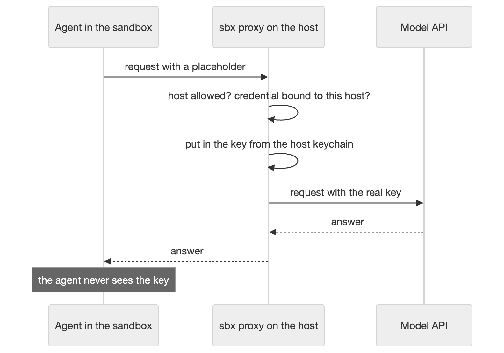

# Accounts and secrets

[← Back to the README](../README.md)

How your accounts reach a sandbox while the secret stays on the host, and the `A` and `S` screens.

## Credentials

The backends `claude-anthropic`, `codex-openai` and `agy` use an sbx service credential. sbx gives a credential only
to the domains in its binding in `~/.config/sbx/credentials.yaml`. aisbx adds this binding for you before it creates,
rebuilds or starts a sandbox, and never removes an entry. A plain `sbx run` asks for the binding on its first
interactive start. **Without a binding, sbx silently withholds the credential** and the agent fails to sign in.
LiteLLM connections and setup tokens need no binding.



## Two Anthropic accounts at once

An Anthropic subscription (Enterprise, Pro, Max) reaches a sandbox in one of two ways:

| | `/login` | Setup token |
| --- | --- | --- |
| Backend | `claude-anthropic` | `claude-token` |
| Accounts | **one per machine**, shared by every `/login` sandbox | **one per token name**, as many as you store |
| Set up | `/login` once, inside any such sandbox | `claude setup-token`, pasted into the wizard once per token |

Use `/login` for the account you use most, and a setup token for a second account. Both work in the same folder at
the same time. The create wizard offers both on its Harness step. `A` changes the choice later.

### `/login`: one account per machine

1. Create a sandbox with the account left on **/login**, and start it.
2. Run `/login` inside Claude Code.
3. Open the printed URL in your **host** browser, sign in and paste the code back.

The host keychain keeps the login for every `/login` sandbox on the host. A rebuild keeps it. `/status` inside
Claude Code shows the account.

**To switch accounts:** in `S`, delete the `/login` row (or run `sbx secret rm anthropic`), then run `/login` again.
This signs out every `/login` sandbox on the host.

### Setup tokens: a second account

A [setup token](https://code.claude.com/docs/en/cli-reference) is a long-lived credential for one account.

1. Run `claude setup-token` while you are signed in as that account, on the host or in a sandbox.
2. In the create wizard, pick **setup token**, then **new token…**.
3. Give the token a short name (lower-case letters, digits and dashes, for example `private`) and paste the value.

Later sandboxes pick the token by its name. The host keychain keeps the token once, and only requests to
`api.anthropic.com` get it.

- **Rotate** a token with `A` or with `↵` in `S`. Every sandbox on that name uses the new value from its next request.
- **Move** a sandbox to another token with `A`. This rebuilds it.
- **Deleting a sandbox never deletes its token.** Delete the token in `S`. Its sandboxes then show
  `⚠ no token — press A`.

**Without the dashboard**, store the token, then add the token kit that aisbx writes for that name:

```console
$ printf '%s' "$TOKEN" | sbx secret set-custom \
    --host api.anthropic.com --placeholder sbx-cs-aisbx-tok-private --value-stdin
$ sbx run --kit ~/.local/state/aisbx/tokens/token-private ./kits/claude-token
```

Store the token before you create the sandbox. To delete it by hand, run
`sbx secret rm --placeholder sbx-cs-aisbx-tok-private -f` and remove the `tokens/token-private` folder.

### Why `claude-token` is its own kit

A setup token on a `/login` sandbox **silently bills the `/login` account**: the `anthropic` credential replaces
every bearer token to `api.anthropic.com` with the `/login` token. `claude-token` declares no credential, so its
requests use the token's account. The three Claude Code backends share the image, the session volumes and the
[shared skills](skills.md#shared-agent-skills) store. No subscription credential reaches a LiteLLM gateway.

## Accounts (`A`)

`A` changes the account or the connection of the selected sandbox.

### On a LiteLLM sandbox

Pick another connection, or *new connection…*, with ←→. Apply asks first, then rebuilds the sandbox onto that
connection.

- The rebuild keeps the ports, rules, mounts, limits, skills mode, MCP servers and model pins.
- The confirmation names each pinned model that the new connection does not list.
- `A` also moves a sandbox whose connection was deleted. It cannot move a sandbox whose folder is gone.

### On an Anthropic subscription

`A` switches a Claude sandbox to `/login`, to another stored token, or to a new token. The sandbox's row shows the
current account (`Claude Code · /login` or `Claude Code · token private`).

- **Rotating** a token, or storing a missing one, is live for every sandbox on that name. It asks first when more
  than one sandbox uses it.
- **Moving** to another token, or between `/login` and a token, rebuilds the sandbox.
- **Between `/login` and a token the session history does not move.** Moving back brings it back.

## Stored secrets (`S`)

`S` lists every credential on the host. Values are masked as sbx prints them:

```text
 ▸ /login (OAuth)          (oauth configured)  2 sandboxes
 ▸ token private           sk-ant********      2 sandboxes
 ▸ token work              ⚠ not stored        1 sandbox
 ▸ litellm acme            litellm.example.com · 2 models · key stored   3 sandboxes
 ▸ mcp:acme:api-key        sk-ant********      MCP gateway: acme
```

Press `↵` to store or replace a value. Press `d` to delete one; aisbx first says which sandboxes lose what.

- **A named token:** `↵` rotates it. `d` deletes it, and its sandboxes show `⚠ no token`.
- **A LiteLLM connection:** see [below](#litellm-connection-rows).
- **A service secret** (`openai`, …) shows even when it is missing. The wizard's Harness step names the command that
  stores it. A change reaches running sandboxes on their next request.
- **`/login`** and **Antigravity sign-in** are signed in inside a sandbox, not here. `d` signs out every sandbox
  that uses them, the way to switch accounts ([`/login`](#login-one-account-per-machine),
  [Antigravity](agents.md#antigravity-agy)).
- **`mcp:` secrets** belong to the [MCP gateway](sandboxes.md#mcp-servers) and never enter a sandbox. Restart the
  sandbox after you change one. aisbx flags a row in an old spelling with the command that fixes it.
- A token of a deleted sandbox is flagged for `d`. aisbx lists custom secrets of other tools and leaves them alone.

### LiteLLM connection rows

A connection row shows the name, the host, the model count and whether its key is stored. *key stored for another
host* means the key does not match the URL's host. A key row with no connection left is an orphan; delete it with `d`.

- **Add:** press `n`. Type the name, the URL and the key, then Save. aisbx refuses a name that exists.
- **Edit:** press `↵` on the row. Leave the key empty to keep the stored one. A new key is live for every sandbox on
  the connection.
- **Change the host or path:** type the key again for a new host. Press `R` on each sandbox of the connection; until
  then they keep the old URL, and on a new host they fail to sign in.
- **Delete:** press `d`. aisbx names the sandboxes on the connection, then deletes its key and its folder. These
  sandboxes stop signing in at once.
