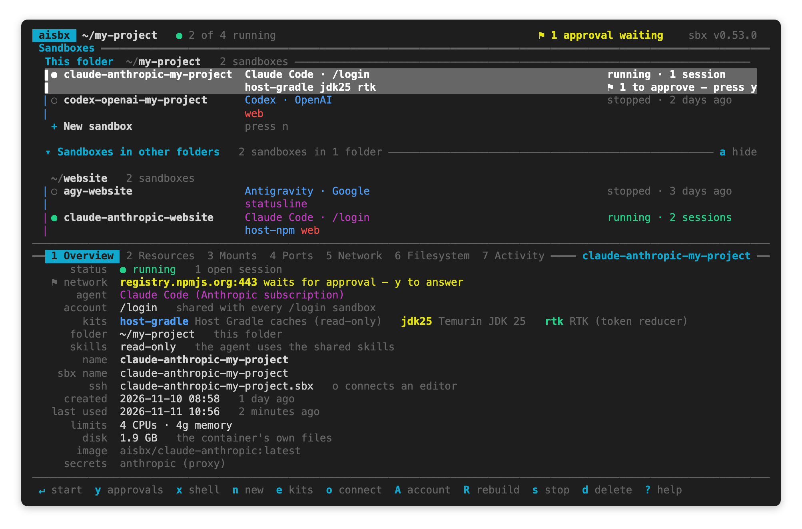
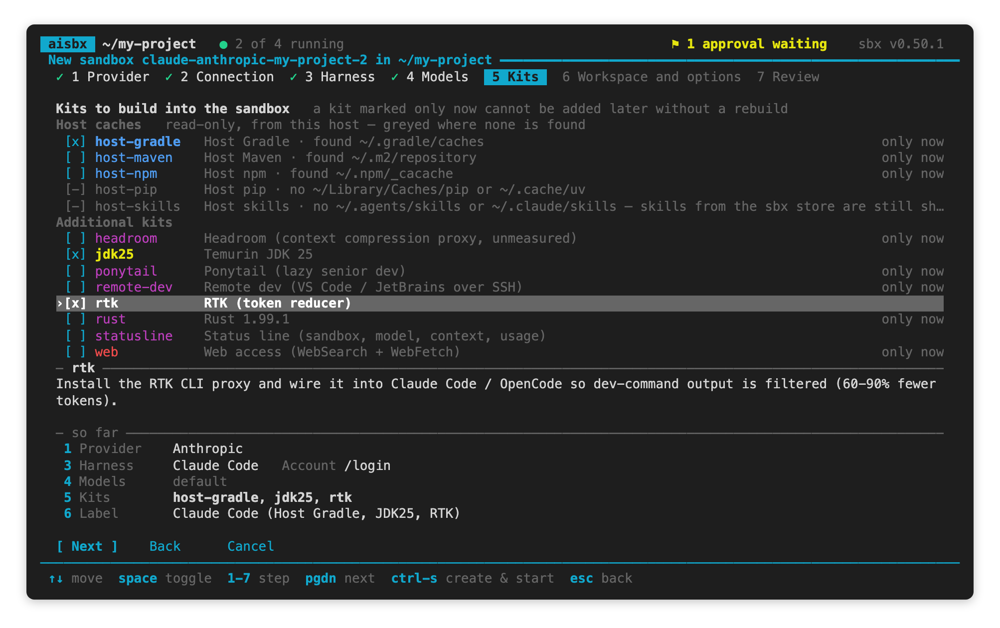

# The aisbx dashboard

[← Back to the README](../README.md)

The terminal dashboard (TUI): how to start it, how it uses sbx, the tasks you do with it, every key, the create
wizard and the details tabs. For the desktop window, see [The aisbx-ui GUI](gui.md). The window has the same
screens and keys.

## How the dashboard works with sbx

The dashboard is a front end to sbx. Each row is one sbx sandbox, and each action runs one or more `sbx` commands.

- **What it shows comes from sbx.** Every 5 seconds the dashboard reads `sbx ls --json`, and `sbx inspect --json`
  for the details. A sandbox that you make with plain `sbx` or with [`aisbx up`](headless.md) is a row too.
- **What it adds on top:** the [kits](kits.md) in `kits/`, your [LiteLLM connections](litellm.md) and
  [setup tokens](accounts.md#setup-tokens-a-second-account), model picks, and the small kits generated for them.
- **What it remembers:** only what sbx does not report, such as labels and start folders
  ([What aisbx remembers](sandboxes.md#what-aisbx-remembers)). Deleting it is harmless.
- **Your secrets stay in sbx.** Keys and tokens go to the host keychain through `sbx secret`. The dashboard keeps no
  copy.

The long-running commands show their output in a [panel](#long-running-work), so you always see what sbx does.

## Common tasks

Select a sandbox, then press the key. In `aisbx-ui`, click the button of the same name.

| Task | Key | What runs |
| --- | --- | --- |
| Create a sandbox | `n` | the [create wizard](#the-create-wizard), then `sbx create` |
| Start the agent | `↵` | `sbx run` |
| Open a shell | `x` | `sbx exec` |
| Add or remove kits | `e` | `sbx kit add`, or a rebuild |
| Rebuild | `R` | `sbx rm` and `sbx create` |
| Answer network requests | `y` | `sbx policy approval respond` |
| Stop / delete | `s` / `d` | `sbx stop` / `sbx rm` |

[Keys](#keys) lists every key. Press `?` in the dashboard for the same list.

## The `aisbx` launcher

Start the dashboard in the folder you work in:

```console
$ cd ~/my-project
$ aisbx
```

```text
aisbx [--here|-a|--all] [--no-mouse] [--no-update]
```

| Option | Does |
| --- | --- |
| `--here` | starts with the *Sandboxes in other folders* section folded away |
| `-a`, `--all` | starts with the *Sandboxes in other folders* section open |
| `--no-mouse` | starts with mouse reporting off, so the terminal selects text |
| `--no-update` | skips the agent update before a start ([Always starting on the current agent](sandboxes.md#always-starting-on-the-current-agent)) |
| `-h`, `--help` / `-V`, `--version` | prints the help, with the [headless commands](headless.md) / the version |

### What each run does

The launcher builds the dashboard when its sources changed, then runs it. `bin/` holds one launcher per platform,
each called `aisbx`. Each platform has its own directory, so a shell completes only the launcher it can run.

| Platform | Put on PATH | Which is |
| --- | --- | --- |
| macOS, Linux | `bin/unix/` | `aisbx`, POSIX `sh`; or symlink it into a directory already on PATH |
| Windows | `bin\windows\` | `aisbx.cmd` → `aisbx.ps1` (PowerShell 5.1 or 7, run with `-ExecutionPolicy Bypass`) |

Each run does these steps:

1. It checks for `sbx`, and for `cargo` if it must build. When one is missing, it names the install command and the
   PATH line.
2. It rebuilds `build/aisbx` next to the launcher when a file under `core/` or `tui/`, or the root `Cargo.toml` or
   `Cargo.lock`, is newer. Files in `target/` and dotfiles do not count. The build is
   `cargo build --release -p aisbx`, on the workspace at the repo root, into its `target/`.
3. It replaces the binary by rename, so a running dashboard is not affected.
4. It runs the dashboard with your arguments.

The launcher exports `AISBX_HOME`, but it never changes directory: the dashboard acts on the folder you start it
in. An up-to-date binary adds about 50 ms.

| Command | Does |
| --- | --- |
| `aisbx --rebuild` or `AISBX_REBUILD=1` | forces a build |
| `AISBX_SKIP_BUILD=1` | runs the existing binary, with no Rust toolchain |

`cargo install --path tui` also works, but that binary and the launcher shadow each other on PATH. Use only one.
However you install it, the dashboard finds `kits/` relative to its binary, or in the checkout it was built from.
`AISBX_HOME` overrides that.

## The screen

The screen shows the sandbox list on top, the details pane of the selected sandbox under it, and the keys in the
footer.



This text version shows more row states: a setup token, a LiteLLM connection, an update, a missing folder and a
foreign kit.

```text
 aisbx  ~/my-project   ● 2 of 4 running                    ⚑ 1 approval waiting    sbx v0.51.0
 Sandboxes ━━━━━━━━━━━━━━━━━━━━━━━━━━━━━━━━━━━━━━━━━━━━━━━━━━━━━━━━━━━━━━━━━━━━━━━━━━━━━━━━━━━━━
  This folder  ~/my-project   2 sandboxes ───────────────────────────────────────────────────
  ▌● My private Claude Code              Claude Code · token private  running · 1 session
  ▌                                      jdk25 rtk                    ⚑ 1 to approve — press y
  ▏○ OpenCode (Web, Host Gradle, Host …  OpenCode · LiteLLM acme      stopped · 3 days ago
  ▏                                      web host-gradle host-maven   ⟳ update ready — press R
   + New sandbox                         press n

  ▾ Sandboxes in other folders   2 sandboxes in 2 folders ───────────────────────────── a hide

   ~/gone  folder not found   1 sandbox
  ▏○ ts-lab                              claude · extern              stopped · 28 days ago

   ~/other-project   1 sandbox
  ▏● Claude Code (JDK25)                 Claude Code · /login         running · background
  ▏                                      jdk25

────────────────────────────────────────────────────────────────────────────────────────────────
━━ 1 Overview  2 Resources  3 Mounts  4 Ports  5 Network  6 Filesystem  7 Activity ━ My priv… ━━
      status  ● running   1 open session
   ⚑ network  registry.npmjs.org:443 waits for approval — y to answer
       agent  Claude Code (setup token)
     account  setup token “private”   no other sandbox uses it
        kits  jdk25 Temurin JDK 25   rtk RTK (token reducer)
      folder  ~/my-project   this folder
      skills  read-only   the agent uses the shared skills
        name  My private Claude Code
    sbx name  claude-token-my-project
         ssh  claude-token-my-project.sbx   o connects an editor
     created  2026-10-28 05:20 UTC   11 hours ago
────────────────────────────────────────────────────────────────────────────────────────────────
 ↵ start  y approvals  x shell  n new  e kits  o connect  w start folder  A account  i repo skills
```

### The list and its sections

- The sandboxes of the folder you started in come first. The `+ New sandbox` row closes this section. On
  `+ New sandbox`, `↵` creates a sandbox instead of starting one, and the details pane is hidden.
- Every other sandbox on the host is under **Sandboxes in other folders**, grouped by folder. A blank line and a
  heading start each folder. The heading names the folder and counts its sandboxes. A folder that is gone says
  *folder not found* on its heading.
- The list never filters a sandbox out. Press `a`, or click the *Sandboxes in other folders* heading, to fold that
  section away and back. The dashboard offers `a` only while another folder has a sandbox.
- The fold is remembered across runs. `aisbx --here` starts with the section collapsed, `aisbx -a` expanded.
- The panel's bottom border says what the window cuts off.
- The top line counts the host's running sandboxes, also those in a folded section, because each running sandbox
  holds its memory. Where the terminal is too narrow, the top line leaves the count out. The `aisbx-ui` header shows
  the same count after the folder.

### Rows and columns

Each sandbox is one row of three columns. The columns line up down the list.

| Column | First line | Second line |
| --- | --- | --- |
| name | status (`●` running, `○` stopped) and label | the [start folder](sandboxes.md#opening-the-agent-in-a-subfolder-w) (`› api`), when one is set |
| runs | the agent, and its connection or account, in the agent's colour | the kits by the names `--kit` takes (`jdk25`, `host-gradle`), in their colours; `+N` counts the ones that do not fit |
| state | `running · 1 session · clone`, `running · background`, `stopped · 3 days ago` | what it needs from you, with the key: `⚑ 1 to approve — press y`, `⟳ update ready — press R`, `⚠ no token — press A`, `⚠ not responding — press s`; a marker follows for each other condition |

- A row has its second line only when it has something to show on it.
- Each sandbox row that is not selected has a thin line in its agent's colour in its first column.
- The selected row has a bar in its first column and a grey band, with all its text bright white. A kit's or an
  agent's colour on grey was hard to read on a light terminal theme, so the selected row gives up its colours.
- On a terminal narrower than 76 columns, the agent moves under the label, with the kits after it. The details pane
  then shows the start folder.
- The details pane's tabs are its top border, with the open tab reversed. The selected sandbox's label closes the
  border on the right, cut short where the tabs leave little room.
- Where the seven tab titles do not fit, the tabs that are not open show only their key.

### Keys

| Key | Does |
| --- | --- |
| `↵` | start the sandbox: the agent is [updated first](sandboxes.md#always-starting-on-the-current-agent), then `sbx run --name …` takes the terminal until the agent exits. On `+ New sandbox`, open [the create wizard](#the-create-wizard) |
| `x` | open a shell inside (`sbx exec -it … bash`), in the folder the agent starts in; starts a stopped sandbox |
| `n` | create a sandbox for this folder, step by step in [the create wizard](#the-create-wizard): agent and connection, kits, name, start folder, [clone mode](sandboxes.md#clone-mode), [skills mode](skills.md#shared-agent-skills), ports, [blocked hosts](network.md#blocked-hosts), [MCP servers](sandboxes.md#mcp-servers) |
| `e` | add or remove kits; on the gateway backend, [pin models](litellm.md#pinning-claude-codes-models-on-the-gateway) |
| `w` | set [the folder inside the workspace](sandboxes.md#opening-the-agent-in-a-subfolder-w) the agent starts in |
| `o` | [connect an editor or app](sandboxes.md#editor-and-app-integrations-vs-code-intellij-claude-desktop) over SSH |
| `A` | [change the Anthropic account](accounts.md#accounts-a) or rotate its token; on a LiteLLM sandbox, move it to another connection |
| `S` | [every secret stored on the host](accounts.md#stored-secrets-s); add (`n`), edit (`↵`) or delete (`d`) a LiteLLM connection |
| `K` | [the shared agent-skills store](skills.md#shared-agent-skills); its *Repo skills for all sandboxes* row picks [repo skills](skills.md#skills-from-skill-repos-aisbx-skill) for every sandbox |
| `i` | this sandbox's own [repo skills](skills.md#skills-from-skill-repos-aisbx-skill), and *Sync now* |
| `F` | [the host folders every sandbox mounts](sandboxes.md#host-folders-f-and-companionjson): add, edit (`↵`) or delete (`d`) one |
| `T` | sbx's settings for this host: [telemetry](network.md#sbxs-own-telemetry-t), [clipboard copy and image paste](sandboxes.md#the-host-clipboard-t) and [FUSE](sandboxes.md#fuse-filesystems-t), each turned on or off with `↵`, and the [skills default](skills.md#share-modes), which `↵`, `←` and `→` walk |
| `p` / `u` | [publish / unpublish a port](sandboxes.md#ports-p--u) |
| `L` | LiteLLM sandboxes: fetch the connection's [model list](litellm.md#the-gateways-model-list) now |
| `b` | [keep the sandbox running](sandboxes.md#keeping-a-sandbox-running-b) after its sessions end, or rebuild it back |
| `y` | [answer requests held for approval](sandboxes.md#requests-held-for-approval-y) (offered while one waits) |
| `c` | check whether a host is reachable from the sandbox (`sbx policy check network`; opens no connection) |
| `r` / `R` | rename (the label only) / [rebuild](sandboxes.md#names-kits-and-rebuilds) from its current kits |
| `s` / `d` | stop / delete |
| `P` | [prune every stopped sandbox](sandboxes.md#prune-stopped-sandboxes-p) on the host |
| `a` | fold the *Sandboxes in other folders* section away, or open it again (while another folder has a sandbox) |
| `↑↓←→` `hjkl`, `g` / `G`, `PgUp` / `PgDn` | move between sandboxes (`↑↓` stop at the ends, `←→` wrap); first / last (`Home` / `End` too); a page up / down |
| `/` | find a sandbox: type part of its name, sbx name, agent, a kit or its folder. The cursor jumps to the first match from where it was, and the list marks each match. `↑↓` (`tab`, `^n` / `^p`) step through the matches, `↵` stays there, `esc` goes back. Nothing is hidden; a match in a folded *Sandboxes in other folders* unfolds it until the search ends |
| `tab`, `1`…`7` | switch the details tab; `^↑` `^↓` scroll it, `m` maximizes it and `esc` restores it |
| `M` | mouse reporting on / off |
| `F5`, `^r` | refresh (automatic every 5 s) |
| `?` | every key, and what the `●` `○` `⟳` `⚑` `⚠` markers mean; a note on a key is dimmed and indented under it |
| `^z` | suspend the dashboard to the shell; `fg` brings it back, redrawn (not on Windows) |
| `q`, `^c` | quit. `esc` never quits, so backing out of a screen once too often keeps you here |

### What stays in place

- The footer always names the keys of what has the keyboard: the list, a form or an open dialog.
- A question's `↵` says what answering does (`↵ rename`, `↵ publish`, `↵ store`).
- Nothing on screen moves unless you moved it. The 5-second refresh redraws only the one cell of its `↻` mark.
- The split between the list and the details pane moves only when a sandbox comes or goes, or *Sandboxes in other
  folders* folds. The details pane is as tall as the longest Overview of the listed sandboxes. On `+ New sandbox`
  the list gets the whole screen.
- Every full-screen form (`S`, `K`, `i`, `o`, `y`, `w`, `e`, `A`) keeps its rows in place too:
  - A strip right under the rows explains the row under the cursor.
  - A rule above the strip names that row and counts the rows scrolled out of view (`↓ 4 more`).
  - The form's buttons are its last line.
- A row too wide for the panel ends in `…`. In a text field, the text before the cursor gives way instead, so a
  pasted token never pushes the cursor off screen.
- The cursor's `›` is the only mark in a row's first columns.

### Long-running work

Long-running work (`sbx create`, `sbx kit add`, `sbx rm`, …) runs in the background.

- A panel streams sbx's output. A line too long for the panel goes on under itself instead of being cut.
- The panel's bottom edge shows a spinner, the running step, the number of steps and how long the job has run.
- A step that fails says which step it was and its exit code.
- The panel stays on screen until sbx is done. Meanwhile `esc`, `q` or `ctrl-c` say so on the status line.

### Interruptions

- A session you end with `ctrl-c` reads as *interrupted*, not as an error.
- `kill` (SIGTERM) or a closed terminal (SIGHUP) ends the dashboard as `q` does, once a running session has ended.
  The terminal is restored and the labels are saved.
- `^z` hands the terminal back to the shell, and `fg` takes it again, redrawn. A running job carries on.
- A crash turns mouse reporting off on its way out, so the shell does not print an escape sequence for each mouse
  move.

### Mouse

- Click a row to select it. Click it again to start it.
- Tabs, form rows, the create wizard's trail and the footer hints are clickable.
- The wheel moves the selection or scrolls the panel under it.
- Mouse reporting takes click-drag away from the terminal. To select text, hold the terminal's override key (usually
  Shift), or press `M` to switch reporting off. `aisbx --no-mouse` starts with reporting off.

## The create wizard

The create wizard makes a new sandbox in seven steps. Press `n`, or press `↵` on `+ New sandbox` or click it.

Both dashboards have the same seven steps, each laid out for how it is used. The terminal shows a numbered trail of
the steps on top, for the keyboard. The window shows a column of the steps on the left, with your answers under each,
like a setup assistant. In both, click a step to go there.



### The seven steps

1. **Provider**: who serves the model. Pick Anthropic, Google, OpenAI, your LiteLLM gateway, or a local engine on
   this computer ([Local inference engines](local.md)).
2. **Connection** (LiteLLM and local engines only; the other providers skip it): one of your
   [connections](litellm.md#litellm-connections), or *new connection…*. The step opens on the last used connection.
   `↵` on a stored connection picks it and goes on.
   - Next reads the connection's [model list](litellm.md#the-gateways-model-list) when it has none younger than a
     day.
   - With *new connection…*, Next stores the key first and then reads the list.
   - On a local engine the step offers your engines, then the engines aisbx found on this computer, marked
     *(found)*, then *new engine…*. A found engine fills in its name, port and key
     ([What aisbx finds](local.md#what-aisbx-finds)).
3. **Harness**: the agent. The step offers only the agents that work with that provider:
   - Anthropic: Claude Code. Under it, pick `/login` or a setup token (a token stored on this host, or
     *new token…*).
   - Google: Antigravity.
   - OpenAI: Codex.
   - LiteLLM: Claude Code, OpenCode or Pi.
   - Local engine: Pi, Claude Code bare, OpenCode or Claude Code. Each says how light it is: a light one needs less
     memory and answers faster. The step warns when the engine's context is too small for the harness
     ([Which harness](local.md#which-harness)).

   When the harness needs a credential that is not stored, the step flags it, with the command that stores it.
4. **Models** (LiteLLM and local engines only; the other providers skip it): the connection's models, read through
   its fetcher, or from the local engine by aisbx itself.
   *Refresh the list* asks the gateway again. Two optional folds follow, closed until you open them:
   - *Pick models*: what the agent starts on, and which models it sees. Untick a model to keep it from the agent.
     Without picks, the agent picks its own models from all of the gateway's.
     - Claude Code: which model `opus`, `sonnet` and `haiku` resolve to
       ([pins](litellm.md#pinning-claude-codes-models-on-the-gateway)).
     - OpenCode: the main and the small model.
     - Pi: the default model.
   - *Config files*: the files the harness gets, for your review. `↵` opens one in an editor
     ([Seeing and editing the config files](litellm.md#seeing-and-editing-the-config-files)).

   A closed fold names what is set under it. The picks are kept per connection and harness. Every sandbox on that
   connection gets the list, and OpenCode's or Pi's picks, at its next start.
5. **Kits**: the *Host caches* first, then the other addons.
   - You cannot tick a host cache that this host has nothing for.
   - The step shows only the addons that work with the harness you picked: the status line and headroom for Claude
     Code, RTK and Ponytail for Claude Code and OpenCode.
   - Most kits can be added only now: adding one later means a rebuild. The terminal marks those *only now*. The
     window marks the few that can be added later, *Can add later*.
6. **Workspace and options**: the label, where the agent starts, more folders to mount, clone mode,
   *`.git` read-only* and the skills mode. *More options* is a fold, closed until you open it, with the ports, the
   [blocked hosts](network.md#blocked-hosts) and the [MCP servers](sandboxes.md#mcp-servers).
   - The wizard makes the label from the agent, the provider, the account and the kits until you type one. The
     first character you type replaces it; an arrow key edits it instead.
   - *Starts in* opens a folder picker. `..` at the top mounts the folder above instead (see
     [A folder above](sandboxes.md#mounting-a-folder-above-the-current-one)).
   - *Mount a folder…* opens the same picker, once for each folder. A picked folder is read-only; pick read-write on
     its row, or remove it. For these folders and *`.git` read-only*, see
     [Host folders](sandboxes.md#host-folders-f-and-companionjson).
7. **Review**: every answer under the step it belongs to, the sbx name and the folders, then **Create & start**,
   **Create only**, **Back** and **Cancel**. An answer still at its default is dimmed. To change a step's answers,
   click them, or press `↵` on them.

### Remembered answers and checks

The wizard remembers the answers of your last create: the provider and harness, the account or connection, the kits
per harness, clone mode, `.git` read-only, skills mode, ports, blocked hosts and MCP servers. The next create opens on
them, on the Review, headed *Prefilled from your last sandbox*. Create there, or pick a step to change its answers.
The label, the start folder and the mounted folders belong to each folder.

- A step with a single choice still shows, with that choice preselected.
- When you change the provider, the harness or the connection, the wizard keeps your answers to the later steps.
- When you pick a provider again, the wizard comes back to the harness you last picked for it.
- Next, the trail and creating stop on a step whose answer would make the create fail, and say why beside the field.
  Examples: a port or blocked host that does not parse, a token or connection field that is malformed, taken or
  empty. A closed fold opens when an answer in it is refused.
- The wizard does not judge a field while you type in it. The problem shows once the cursor moves on, or as soon as
  the wizard refused a step.

### Leaving and coming back

- `esc` on step 1 and `ctrl-c` close the wizard and keep your answers. The next `n` in the same folder opens them
  again where you left off, and says so.
- **Cancel** discards your answers.
- A create that fails brings the wizard back on its Review with every answer. Only a pasted token or gateway key is
  gone: paste it again.

### In the terminal

The terminal wizard is built for the keyboard, in a frame that does not move.

- The panel's title names the sandbox it will create: its sbx name, which changes with the harness and the account.
- The row under the cursor is highlighted and marked `›` in its first column, so it shows without colour.
- A field whose answer would be refused is marked `!` in its first column.
- A help strip of fixed height under the rows explains the row under the cursor: what it does with its answer, and
  what is wrong with it.
- Moving the cursor never moves a row.
- On a terminal of 32 rows or more, a ledger above the help strip shows what `ctrl-s` would create from any step. It
  has one line per step, with what the step decided and every answer you changed from its default. Click a line, or
  type its number, to go to that step.

| Key | Does |
| --- | --- |
| `↑` `↓` `tab` | move between rows; the buttons are one row, and `←` `→` move along them |
| `j` `k` / `h` `l` | as `↓` `↑` / `←` `→`, on any row that does not take typing |
| `space` / `↵` | tick a box, pick a radio, show or hide a fold; `↵` on a provider, harness or account radio, or on a stored connection, picks it and goes on (a harness to the rows under it, if any) |
| `←` `→` | pick a value on a row that has several: the connection, the skills mode, a mounted folder's access |
| `del` | remove a mounted folder |
| `1`…`7` | go to that step, from any row that does not take typing (forward only past steps whose answers pass) |
| `pgdn` / `pgup` | the next / the previous step, from any row |
| `ctrl-s` | create and start, from any step |
| `esc` | one step back, keeping every answer; on step 1, close the wizard |
| `ctrl-c` | close the wizard, keeping the answers for the next `n` |
| `ctrl-u` / `ctrl-w` / `ctrl-k` | in a text field: delete to the start, the word before the cursor, to the end (`ctrl-a` / `ctrl-e`: go to the start / the end) |

The footer names what `space` and `↵` do on the row under the cursor.

#### Narrow terminals, no colour, no UTF-8

These rules apply to every screen of the dashboard, with the same layout:

- On a narrow terminal, the footer leaves out whole hints, `pgdn` first. It never cuts a hint in half.
- On a narrow terminal, the trail shortens to the current step's title and the other steps' numbers, then to the
  current step alone.
- On a terminal without colour (`NO_COLOR` set to anything), every colour goes. The cursor's highlight becomes
  reverse video.
- Where the locale is not UTF-8 (`LC_ALL=C aisbx`), every symbol is one ASCII character. The footer and the `?` sheet
  name the arrow keys, `↵` and `⇧` in words.

### In `aisbx-ui`

The window wizard is a form to read and point at.

- Each choice is a tile or an item that says what it is:
  - The agents are tiles, as many to a line as the window fits.
  - The connection's ways are tiles. The chosen one's connection, tokens or fields are set in under it.
  - Each kit has a line from its own description.
- A text answer is an input box. Its label is above it. Under it is what goes in it, or what is wrong with it once
  that is worth saying; then its edge turns red.
- The LiteLLM connections are tiles too, with *Last used* on the one used last.
- The skills mode and each mounted folder's access are segmented controls. Each takes one click.
- *Pick models*, *Config files* and *More options* are folds, marked *Optional*. Click one to show or hide what it
  holds. A closed fold names what is set under it.
- Every control's tooltip holds the terminal's help text for it. Core's cursor is a ring around the control.
- Each control tells screen readers its role and state. A secret's field reports dots only.
- The column of steps at the left starts with the sandbox being built and its sbx name. Each step then has a tick
  once you are past it and, under its title, what it decided and each answer you changed. Click a step to go there.
- A window narrower than about 860 points keeps only the steps' numbers in that column; hover one for its answers.
  The sandbox's name then shows over the step.
- The generated label is dimmed until you type your own.
- In a text field, `Option`-`Backspace` on a Mac and `Ctrl`-`Backspace` elsewhere delete the word before the cursor.
  `Cmd`-`Backspace` on a Mac deletes the text before it.
- The review groups the answers by step, each group with an **Edit** button.
- The buttons sit as a desktop window has them: **Cancel** at the left edge, **Back** and the main action at the
  right, the main action filled. `←` `→` move along them in the direction they point. This holds for every form in
  the window.

## Details tabs

The details pane shows the selected sandbox in seven tabs. Press `tab` or `1`…`7` to switch.

| Tab | Shows | From |
| --- | --- | --- |
| `1 Overview` | what needs you first: status (and an unresponsive guest), where the requests waiting for approval go, a missing secret, keep-running. Then agent, account, pinned models and kits, folder, start folder and skills mode, names and SSH host, created / last used and CPU/memory limits, image, injected secrets, MCP servers. On a wide terminal, the names and everything after them are in a second column | `sbx ls --json`, `sbx inspect --json`, `sbx policy approval ls --json` |
| `2 Resources` | vCPUs and load, memory, disk, uptime (the sandbox's own, not the host's). From the second reading on, CPU and memory also show as sparklines of the readings taken while the tab is open, beside their meters where the terminal is wide enough | `sbx exec` of a `/proc` + `df` probe |
| `3 Mounts` | every folder sbx mounts from the host: the workspace, extra folders, the skills store, folders added later with `sbx mount`. Each with its path in the sandbox where that differs, read-write or read-only, and a warning when the host folder is gone | `sbx inspect --json`, `sbx ls --json` |
| `4 Ports` | port forwards, as URLs | `sbx ports <name> --json` |
| `5 Network` | every network rule that applies (allow / deny, HTTP method / path), where it came from (`kit`, `added`, `approved`, `preset`, `org`), and `all sandboxes` on a rule of the host-wide policy (a rule of the sandbox's own says nothing) | `sbx policy ls <name> --json` |
| `6 Filesystem` | the filesystem read / write rules | the same call |
| `7 Activity` | the proxy's log: hosts allowed and blocked, with counts, last seen and why | `sbx policy log <name> --json` |

### When the tabs read their data

- Overview and Mounts come with the list snapshot.
- Every other tab costs one `sbx` call. The dashboard makes it only for the selected sandbox, while that tab is open.
- **Resources** has no sbx metrics command behind it, only an `sbx exec`. So the dashboard never measures a stopped
  sandbox, because `sbx exec` would start it.
- It measures a running sandbox only while the tab is on screen, because each probe is a session that keeps the
  sandbox alive. CPU load needs two readings.
- **Created** and **last used** are sbx's own `created_at` and `last_used_at`. Created is the time of the
  *container's* creation, so a `sbx kit add`, which swaps the container, moves it.
- Last used is the one timestamp a stopped sandbox has. Check it before you
  [prune the stopped sandboxes](sandboxes.md#prune-stopped-sandboxes-p) with `P`.
