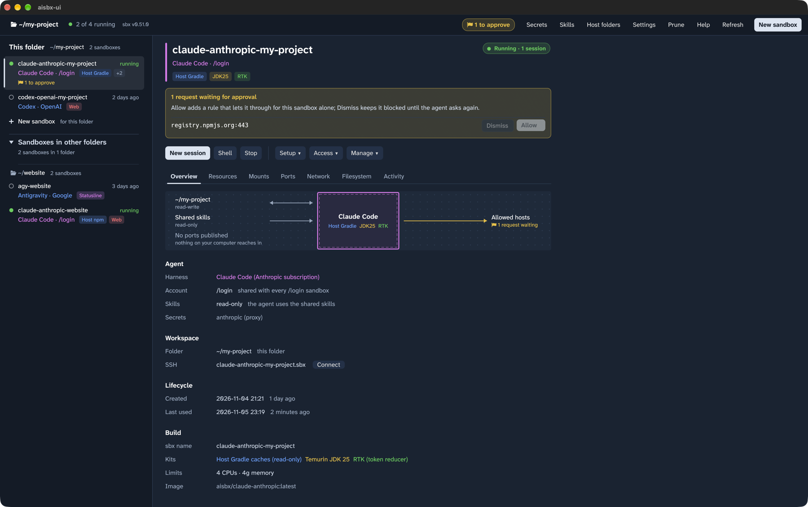

# The `aisbx-ui` GUI

[← Back to the README](../README.md)

The desktop window (GUI) on the same core as the terminal dashboard: how to start it, the tasks you do with it, and
each part of the window.

`aisbx-ui` is a front end to sbx, as `aisbx` is. Both show the same sandboxes, read from sbx, and run the same `sbx`
commands. The window does everything the terminal dashboard does, so [The aisbx dashboard](dashboard.md) applies here
too. Only the headless commands (`aisbx up | run | status | stop | rm`, …) are not in it: run them in a shell
([Headless use](headless.md)).



## Starting the window

Start the window from a shell, in the folder you work in:

```console
$ cd ~/my-project
$ aisbx-ui
```

The launchers are:

| Platform | Launcher |
| --- | --- |
| macOS, Linux | `bin/unix/aisbx-ui` |
| Windows | `bin\windows\aisbx-ui.cmd` |

They build and update the window as [the `aisbx` launcher](dashboard.md#the-aisbx-launcher) does. Do not start the
window from Finder or the Dock: a window opened there has no shell PATH.

```text
aisbx-ui [--here|-a|--all] [--no-update] [FOLDER]
```

| Option | Does |
| --- | --- |
| `FOLDER` | shows FOLDER's sandboxes first, as if you started the window there |
| `--here` | starts with the *Sandboxes in other folders* section folded away |
| `-a`, `--all` | starts with the *Sandboxes in other folders* section open |
| `--no-update` | skips the agent update before a start |
| `-h`, `--help` / `-V`, `--version` | prints the help / the version |

### The folder chooser

Click the header's folder button, or press Ctrl-O (Cmd-O on macOS), to open the folder chooser. It offers:

- the folders the host's sandboxes use;
- a path field (`~` is home, and a relative path starts at the folder shown);
- a small folder browser.

Picking a folder only regroups the grid. Nothing is stored. The chooser opens by itself when FOLDER cannot be opened,
and at a filesystem root with no FOLDER. A filesystem root is where Finder, the Dock and desktop menus start a GUI.

### Requirements

- Rust 1.95 or later.
- On Linux: OpenGL (Mesa) and libxkbcommon. Add libwayland-client on a Wayland desktop, where the window runs
  natively. Else add libxkbcommon-x11 and the X11 client libraries.

Screen readers see the window (AccessKit), and text copies and pastes.

## Common tasks

| Task | In the window |
| --- | --- |
| Create a sandbox | **New sandbox** in the header |
| Start the agent, open a shell, stop | **Start**, **Shell**, **Stop** on the sandbox's page |
| Kits, account, connect an editor, rebuild, delete | the menus *Setup ▾*, *Access ▾* and *Manage ▾* on the page, or a right click on the row |
| Secrets, skills, prune | **Secrets**, **Skills**, **Prune** in the header |

Every key of [`aisbx`](dashboard.md#keys) works in the window too, and each button's tooltip names its key.

## Look and feel

The window opens maximized. It is laid out to be read and pointed at, not driven by keys, and it does not look like
the terminal. It shows one sandbox at a time, beside a list of them.

- **Typeface:** Atkinson Hyperlegible Next, bundled under the SIL Open Font License. It draws look-alike letters such
  as `I`, `l` and `1` apart. Titles, headings and the main buttons use its semibold weight.
- **Colour:** what acts is in the ink of the text (the terminal's accent is cyan). Colour only marks a state, or an
  agent's or kit's family.
- **Size and contrast:** text is never smaller than 12 points. Every text reads at 4.5:1 or more on its background
  (WCAG AA), in the light and the dark theme.

## The sandbox list

The list down the left shows the sbx check (with *Retry*), then the sandboxes. It has the dashboard's sections and
folder headings. Each sandbox has two lines, and a third one when it needs something from you:

1. The status dot and the label, with the status at the right edge. For a stopped sandbox, the status is when it was
   last used (*3 days ago*). The hollow dot says it is stopped, and the tooltip gives the whole state.
2. The agent and account in the agent's colour across the whole row, with the kit badges tinted in their colours.
3. Only while the sandbox needs something from you: the note, with the markers after it.

- Drag the list wider than 560 points to get the dashboard's [columns](dashboard.md#the-screen) back.
- Tooltips name each marker and the key that fixes the note. They also show a value the row had to cut.
- Click a row, or use the arrow keys, Home, End and PageUp/PageDown, to select.
- Click the *Sandboxes in other folders* heading to collapse or expand it. The window remembers this, as with `a`.

## The sandbox page

The rest of the window is the selected sandbox's page. From top to bottom:

1. **The head:** the label as the title, with its state as a pill at the right (*Running · 1 session*,
   *Stopped · 3 days ago*). The agent's colour runs down the edge of the head. Then come the agent and its account or
   connection, and every kit as a badge.
2. **A callout**, while the sandbox needs something from you. It says what, with the fix as a button: *Rebuild* for
   changed kits, *Store a token*, *Stop* for a sandbox that is not responding.
   - You answer requests waiting for approval in the callout. Each has a line of its own with where it goes, why
     (under an organization's policy), and its own *Dismiss* and *Allow*.
   - Past three requests, the callout counts the rest beside *All requests*.
3. **The toolbar:**
   - *Start* (↵, or a double click). On a running sandbox it is *New session*, which opens one more session of its
     agent.
   - *Shell* (`x`) and *Stop*.
   - The rest in three menus: *Setup ▾*, *Access ▾* and *Manage ▾*. *Delete* is last, in red. Each menu's tooltip
     names what is in it.
4. **The [details tabs](dashboard.md#details-tabs)**, a line of underlined titles. Click one, or press `1`…`7`; the
   tab's tooltip names its key. The tabs show what the dashboard's tabs show.

## The Overview map

The Overview opens with a map of what the agent can reach, drawn on a dotted field.

- **The chamber:** the sandbox is a walled chamber (a solid wall, with a dashed liner inside it). The agent and every
  one of its kits are inside, on as many lines as they take.
- **Running or stopped:** while the sandbox runs, the wall is in the agent's colour, the chamber is tinted with it and
  the arrows are solid. While it is stopped, the wall is grey and the arrows are dashed.
- **Left side:** the host's folders the sandbox sees, and the ports the host reaches it on.
  - The folders are the workspace (*read-write*, or *read-only (clone mode)*), any other folders by access, and the
    shared skills store.
  - Each arrow points the way it crosses, both ways for read-write.
- **Right side:** the way out, and the requests waiting for an answer. The way out is *Allowed hosts* through the sbx
  proxy, or *Every host* in the warning colour with the `web` kit.
- Click a crossing to open the tab that lists it (*Mounts*, *Ports*, *Network*). Its tooltip says what the mode
  means.

Under the map, the Overview groups its facts under *Agent*, *Workspace*, *Lifecycle* and *Build*. Each value has its
explanation beside it. The name, the state and a waiting request are in the head, not here.

## The other tabs

The tabs that list things show them as tables, under a heading with their count:

| Tab | Shows |
| --- | --- |
| *Mounts* | every folder sbx mounts from the host, with its path in the sandbox where that differs, its access, and *Missing* when the host folder is gone |
| *Ports* | the published ports, with an *Unpublish* on each and *Publish port* on the heading |
| *Network*, *Filesystem* | the rules under *Blocked* and *Allowed*, each with who put it there (*Kit*, *Added*, *Approved*), and *All sandboxes* on a rule of the host-wide policy; *Check host* on the first heading |
| *Activity* | the hosts the proxy blocked and allowed, with how often, when last and why |
| *Resources* | adds live charts of the sandbox's CPU % and memory over the last five minutes |

- Where a row of a tab names something to do, it has a button for it: *Connect* beside the SSH host, *Rebuild*
  beside changed kits.
- A key inside a tab's sentence is a keycap you can click. Its tooltip names the action.
- On the *+ New sandbox* row, the page names the folder and offers *Set up a sandbox*.

The Resources charts sample every 2.5 s while the tab is open. Hover a chart to read a point.

- A gap in a line is a time when the tab was closed or the sandbox restarted.
- Switch to another sandbox and back, and the chart stays, until the sandbox stops.

## The header

The header shows:

- the folder, as the page's title;
- a spinner while the window reads the sandboxes;
- the requests waiting for approval (hover for the list, click to answer them);
- the host's actions: *Secrets*, *Skills*, *Host folders*, *Settings*, *Prune*, *Help*, *Refresh* (F5, Ctrl-R) and,
  at the right edge and filled, *New sandbox*.

Messages pop up at the bottom right, errors in red with a ×. A button that cannot run is greyed out, with the reason.
Each button is a dashboard key too.

## Starting a session

*Start* runs the pre-start steps in the background, then opens a terminal window:

| Platform | Terminal |
| --- | --- |
| macOS | Terminal.app. macOS asks once for Automation consent. When Terminal.app was not running, the session goes into the window it opens as it starts |
| Windows | Windows Terminal or `cmd start` |
| Linux | the first on PATH of `x-terminal-emulator`, `gnome-terminal`, `konsole`, `xfce4-terminal`, `wezterm`, `kitty`, `alacritty`, `foot`, `xterm` |

To choose the terminal, set `AISBX_TERMINAL`, for example `AISBX_TERMINAL="xterm -e"`.

A failed session waits for Enter. Without a terminal, a dialog shows the command.

## Forms, menus and pages

The window has the dashboard's forms. It shows them as the create wizard, pages, menus and dialogs.

- **New sandbox:** *New* (`n`, or a click on *+ New sandbox*) opens the dashboard's create wizard, with its keys and
  clicks. Secrets show as dots.
- **Right-click menu:** a right click on a row lists its actions as the page groups them: the first three, then
  *Setup*, *Access* and *Manage*, with *Delete* last in red. The host-wide actions are in a submenu, *This host*.
- **Same as in `aisbx`:** *Kits* (`e`) and *Refresh models* (`L`).

### Pages

`A`, `S` (with the LiteLLM connection dialog), `K`, `i` and `y` each open a page of their own. A page is a centred
column under the page's title, with its buttons along the window's foot.

- The account forms and the connection dialog use the wizard's tiles, radios and input boxes.
- The pages that list things show every item with its own buttons: *Allow* and *Dismiss* on a request; *Edit*,
  *Replace*, *Store*, *Delete* or *Sign out* on a secret; *Remove* on a skill; *New LiteLLM connection* on `S`.
- A click on an item selects it and shows what core says about it under it. The keys work as in `aisbx`.
- Tokens and keys show as dots.

### The Connect page

`o` opens the Connect page: *Set up SSH now*, then each app with its *Open*.

- Terminal (ssh) opens in a terminal window.
- VS Code and Cursor start directly, with no terminal window. When a launcher exits with an error within 3 seconds, a
  message pops up. When a launcher is not on PATH, its *Open* is greyed out and says why.
- A click on JetBrains or Claude Desktop shows their steps.

### Questions and confirmations

These keys ask the dashboard's questions and confirmations:

- `w` (start folder);
- `p` / `u` (publish / unpublish a port). `u` offers the only port the Ports tab lists, as in `aisbx`. A port's own
  *Unpublish* names that port;
- `c` (check a host), `b` (keep running), `R` (rebuild) and `P` (prune).

A dialog's answer is at its right edge, filled and named by what it does (*Rename*, *Publish*, *Store*, *Delete*).
*Cancel* is before it.

## Long work

Long work shows its steps as a checklist under a bar that fills step by step. The bar shows *Step 2 of 3* and how
long the job has run.

- A finished step is ticked, with the time it took. Click it to show its output.
- The running step has a spinner, with sbx's output under it.
- The steps to come are empty rings.
- A step that fails is marked red, with its output open. The reason under the list names the step and its exit code.
- When sbx refused to add a kit, the window offers *Rebuild instead*.

## Help

`?` opens *Actions and keys*, a list of what you can do. It shows, in the page's groups:

- each action's name and one-line summary (also each button's tooltip);
- its keys, drawn as keys at the right edge;
- then the window's own keys.

A command, a path or a name that the terminal writes between backticks (`` `sbx setup ssh` ``) shows in the monospace
face on a grey chip, without the backticks.

## The kits editor

The kits editor groups the kits as the wizard's Kits step does, *Host caches* first. Point at a kit to see its full
description and what adding or removing it costs on this sandbox.
