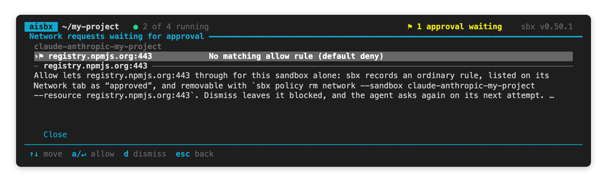

# Working with sandboxes

[← Back to the README](../README.md)

The everyday tasks of the dashboard, one section each. [Without the dashboard](#without-the-dashboard) gives the plain
`sbx` commands.

## Names, kits and rebuilds

Each sandbox has a name, a set of kits, and a container that sbx builds from those kits.

### Names

- The **label** is the text you type, or a generated one such as `OpenCode (RTK, JDK25)`. Press `r` to change it. The
  [status line](addons.md#status-line-inside-the-sandbox) prints it.
- The **sbx name** is `<backend>-<folder>`, with `-2`, `-3` for repeats.
  The dashboard sets it. It allows only letters, digits, dots and hyphens, so put free text into the label.

### Adding and removing kits (`e`)

Press `e` to add or remove kits.

| Kit | What an add does |
| --- | --- |
| `jdk25`, `rtk`, `statusline` | adds the kit live, in about a minute; the workspace, session history and installed tools stay |
| `web`, `remote-dev`, `rust`, `headroom`, `ponytail` | fails, because the kit widens the network rules; the dashboard offers a rebuild |
| `host-npm`, `host-pip`, `host-gradle`, `host-maven`, `host-skills` | fails, because the kit needs mounts fixed at creation; the dashboard offers a rebuild |

To remove a kit, rebuild: sbx has no "kit remove".

### Rebuilding (`R`)

Press `R` to delete the sandbox and create it again with the same name, workspace and kits. Rebuild to apply a kit
change, to remove a kit, or to leave detached mode.

A rebuild deletes the container and everything you installed in it. It keeps the workspace files, the `/login`, a
named setup token, and the agent's session history. It carries over
published ports, clone mode, the skills mode, the MCP set, the CPU and memory limits, `sbx mount` folders, the
sandbox's own network rules and detached mode. The confirmation names each one.

#### Limits

- **A sandbox whose folder is gone is not rebuilt.** Restore the folder, or delete the sandbox.

### Update detection (`⟳`)

A kit edit never reaches an existing sandbox. The dashboard marks a sandbox that a rebuild would change, and the
details quote the kit's newest lines from `kits/<kit>/changes.txt`.

| Mark | Meaning |
| --- | --- |
| `⟳ update ready — press R` | a kit the sandbox was built from has changed |
| `· extern` | the sandbox was not built from these kits: you can start, stop and delete it, but not edit its kits |

### What aisbx remembers

aisbx remembers only what sbx does not report: labels, clone mode, the skills mode, the MCP set, start folders, kit
hashes and UI preferences. It never stores a token. The registry is
`${XDG_STATE_HOME:-~/.local/state}/aisbx/registry.json` (`%LOCALAPPDATA%\aisbx\state\` on Windows). The
generated kits are next to it, in `tokens/` and `models/`. You can delete all of it: labels fall back to sbx names,
and the next rebuild writes the generated kits again.

## Ports (`p` / `u`)

A dev server in a sandbox is unreachable from the host until you publish a port. Press `p` and type the spec, then
open the URL that `4 Ports` lists. Press `u` to remove a port. The create wizard also takes ports.

| Spec | Binds |
| --- | --- |
| `8080:3000` | host 8080 to sandbox 3000 on IPv4, so `http://localhost:8080` works |
| `8080:3000/tcp` | host 8080 to sandbox 3000 on IPv4 and IPv6 |
| `3000` | a host port the OS picks, which changes on every restart |

Make the service listen on `0.0.0.0`. Keep the sandbox running with [`b`](#keeping-a-sandbox-running-b).

## Keeping a sandbox running (`b`)

A sandbox stops about half a minute after its last session. Press `b` to keep it running, for example for a dev
server. This **detached mode** lasts across stop and start, and the row says `running · background`. Press `s` to
stop the sandbox. To leave detached mode, rebuild: `b` offers it (`auto-stop` in the footer).

## Requests held for approval (`y`)

A sandbox can hold a network request until you answer it ([Network policy](network.md#network-policy)). The header
shows `⚑ N approvals waiting`.

1. Press `y`. The list shows each request with its sandbox, destination and reason.
2. Press `a` or `↵` to allow it, or `d` to dismiss it. In `aisbx-ui`, click *Allow* or *Dismiss*.

**Allow** adds a rule for that host and port to the asking sandbox only, shown as `approved` in its Network tab.
**Dismiss** keeps the host blocked, and the next attempt asks again. To remove an allowed rule, run
`sbx policy rm network --sandbox <name> --resource <host:port>`.



## Prune stopped sandboxes (`P`)

Press `P` to delete **every stopped sandbox on the host**. A running sandbox is never deleted. The confirmation lists
each sandbox that will go.

| Deleted | Kept |
| --- | --- |
| the container | workspace files |
| sandbox-scoped secrets | named tokens, the `/login`, the skills store, kit volumes (the session history) |

## Always starting on the current agent

An agent updates itself only for its next launch. So `↵` prepares the sandbox first:

1. It writes the label for the status line.
2. With [`host-skills`](addons.md#host-skills-read-only), it links the host's skills.
3. On an OpenCode or Pi sandbox on a connection, it writes the
   [model list](litellm.md#the-gateways-model-list) and your picks into the agent's config.
4. It updates the agent ([OpenCode](agents.md#opencode) has its own version rule).

The update takes about 2 s when nothing is new. If it fails, the agent starts on what it has. `aisbx --no-update`
skips only the update. `x` skips all four steps.

## Mounting a folder above the current one

Use this to start the agent in `~/repo/api` but mount all of `~/repo`.

1. In the create wizard, press `↵` on the *Opens in* row.
2. Choose `..`: *mount `~/repo` instead*.
3. Go back into `api` and choose **Use**.

The sandbox mounts `~/repo` and takes its name from it. It shows under *This folder* in `~/repo/api`. `..` never goes
up to your home folder. You cannot change the mount of an existing sandbox.

## Opening the agent in a subfolder (`w`)

Use `w` when the workspace holds several projects, to open the agent in one of them with its `CLAUDE.md`, settings
and session history. Press `w`, pick the folder, and choose **Start here** or **Use, don't start**.

The mount does not change, so the agent can still `cd ..`. The choice survives a rebuild and shows under the label as
`› <folder>`. A deleted folder falls back to the workspace root. `w` works for Claude Code and OpenCode.

### How the start folder works

`sbx run` has no working-directory flag, so the dashboard starts the agent with `sbx exec -w <dir>`. Claude Code
opens the folder without a trust prompt.

## Editor and app integrations (VS Code, IntelliJ, Claude Desktop)

Every sandbox is an SSH target at **`<sbx name>.sbx`**. Press `o` to list the ways in. The first time, choose *Set up
SSH now*.

| App | What `o` does |
| --- | --- |
| Terminal | hands the terminal to `ssh <name>.sbx` (`sftp` and `scp` work the same way) |
| VS Code | runs `code --remote ssh-remote+<name>.sbx <workspace>`; needs the [Remote - SSH](https://marketplace.visualstudio.com/items?itemName=ms-vscode-remote.remote-ssh) extension |
| Cursor | the same, with `cursor` |
| IntelliJ IDEA / JetBrains | prints what to enter in JetBrains Gateway → *New connection → SSH*: host `<name>.sbx`, user `agent`, the project path |
| Claude Desktop | prints what to enter under *environment drop-down → + Add SSH connection*: **SSH Host** `<name>.sbx`, port and identity file empty |

- Open the workspace path that `o` prints. An editor may open `/home/agent` instead.
- Under `deny-all`, add the `remote-dev` kit, at creation or with a rebuild. The editor downloads its server into the
  sandbox, and the kit allows only those download hosts (`kits/remote-dev/remote-dev.yaml`).

### Other SSH apps

Other SSH apps, such as T3 Code and Orca (user `_default_user_`), connect the same way. `o` does not list them.

`sbx setup ssh --auto-create` (macOS and Windows) adds connections to ChatGPT and Claude Desktop. Quit both apps
first. Each connection creates its own [mountless sandbox](#mountless-sandboxes), not a way into the selected one.
`sbx setup ssh remove` takes the connections out and keeps the sandboxes.

## MCP servers

sbx registers [MCP](https://modelcontextprotocol.io) servers on the host and lends them to sandboxes. The host keeps
each server's OAuth token. Register a server, then tick it in the create wizard. The set is fixed at creation, and a
rebuild repeats it. To attach or detach a server on a running sandbox, use `sbx mcp load` / `unload`.

```console
$ sbx mcp add notion --url https://mcp.notion.com/mcp                      # remote, OAuth discovered
$ sbx mcp add gh --command npx --args @modelcontextprotocol/server-github  # local stdio
$ sbx mcp auth notion                                                      # authorize, host-side
$ sbx mcp load notion --sandbox my-sandbox                                 # attach now, until a rebuild
```

## Host folders (`F`) and `companion.json`

A sandbox can mount more folders beside its workspace, each at its own host path:

- **The folders the workspace's `companion.json` names**, for a public repo with a private companion repo. The public
  repo is read-write. Each related folder is `read` (the default) or `write`, as `access` says. Paths are relative
  to the workspace.
- **The host's own list**, for every sandbox. Press `F` to edit it. Give each folder a one-line purpose and choose
  read-only or read-write.

```json
{"public": "../my-project", "related": [{"path": "../knowledge-base", "purpose": "…", "access": "read"}]}
```

The agent's instructions file names each folder, its access and its purpose. A change reaches a sandbox at its next
create or rebuild. Read-only holds also for `sudo` in the sandbox. aisbx never mounts a missing folder, one inside the
workspace, your home folder or a folder above it, or a folder that holds credentials; the wizard's Review names each.

**`.git` read-only.** Tick *`.git` read-only* in the create wizard. The agent can read the history but cannot commit,
check out, or change the hooks or config, so no hook it writes runs on your host. You cannot hide `.git` from the
agent. [Clone mode](#clone-mode) is the other way to keep your repo untouched.

## Clone mode

By default the agent edits your working tree. Tick **Clone mode** in the create wizard to give it a private clone in
the container, for example for parallel agents or untrusted code. Your repo is mounted read-only and gets a
`sandbox-<name>` Git remote. Clone mode needs a Git workspace, is fixed at creation, and survives a rebuild.

```console
$ git fetch sandbox-<name> && git log sandbox-<name>/<branch>
```

## Mountless sandboxes

A mountless sandbox has no host folder. The agent works in `/home/agent/workspace`, and the files go with the sandbox:
copy them out with `sbx cp` before you delete it. The dashboard lists one as `no host folder (mountless)`, offers no
`w`, and rebuilds it mountless. It never creates one.

```console
$ sbx create --name scratch ./kits/claude-anthropic
$ sbx cp scratch:/home/agent/workspace/out.log ./
```

## CPU and memory limits

Every sandbox aisbx creates gets **4 CPUs and 4 GiB of memory**, and a rebuild keeps its limits. A small host gets
less: never more CPUs than it has, and never more memory than half the host. To set other limits, use
[`aisbx up --cpus N --memory SIZE`](headless.md) (`auto` takes sbx's default).

### Why 4 CPUs and 4 GiB

sbx's default gives each sandbox every CPU and half the memory, so two busy sandboxes can fill a 16 GiB host. A C
build and a Gradle build ran as fast at 4 CPUs and 4 GiB.

## Without the dashboard

| Task | Command |
| --- | --- |
| Add a kit (absolute path, no trailing slash) | `sbx kit add <sandbox> "$PWD/kits/jdk25"` |
| Rebuild | `sbx rm`, then `sbx create` with the same name, workspace and kits |
| Publish a port | `sbx ports <name> --publish 8080:3000` |
| Keep running | `sbx run --detach --name <sandbox>` |
| Answer a request | `sbx policy approval respond <id> --option allow` (or `dismiss`) |
| Prune | `sbx prune --dry-run`, then `sbx prune`; add `--filter until=168h` to keep what stopped in the last week |
| Connect over SSH | `sbx setup ssh` once, then `ssh <name>.sbx` |
| Detach an MCP server | `sbx mcp unload notion --sandbox my-sandbox` |
| Host folders | `aisbx folders add ~/notes --purpose "..."` (`--write` for read-write), `aisbx folders ls`, `aisbx folders rm ~/notes` |
| `.git` read-only | `aisbx up --git-readonly` |
| Clone mode | `sbx run --clone ./kits/claude-anthropic` |
| CPU and memory | `sbx create --cpus 4 -m 4g ./kits/claude-anthropic .` |

On your own terminal, `sbx kit add` asks you to confirm a kit that widens the network rules.
